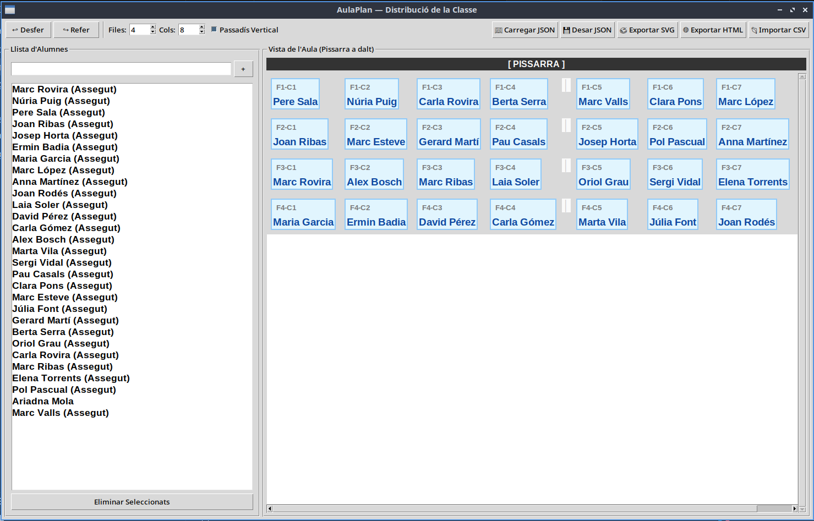

# 🏫 AulaPlan — Distribució i Gestió de la Classe

**AulaPlan** és una aplicació d'escriptori desenvolupada en Python i Tkinter per a la gestió visual, intuïtiva i flexible de la distribució d'alumnes a l'aula. Permet als docents organitzar els seients mitjançant l'arrossegament i soltada (*drag & drop*), configurar les mides de la graella, afegir un passadís personalitzat i exportar el resultat en múltiples formats.

---


## 🚀 Característiques Principals

- **Visualització d'Aula Interactiva**:
  - Interfície adaptada a la mida de la classe amb vista de la pissarra a la part superior.
  - Targetes de seient grans i llegibles amb identificació de fila i columna (ex: `F1-C2`).
  - Indicació clara dels seients ocupats i lliures.

- **Funció Arrossegar i Soltar (*Drag & Drop*)**:
  - Assigna alumnes des de la llista lateral cap a qualsevol seient buit.
  - Intercanvia alumnes de posició arrossegant-los entre seients.
  - Desassigna un alumne arrossegant-lo des del seu seient de tornada a la llista lateral.

- **Feedback Visual de Destacat (Highlight)**: Cada vegada que es col·loca o mou un alumne de seient, es destaca automàticament en color blau intens durant 1 segon tant a la llista lateral com a la taula assignada.

- **Control del Passadís Vertical**: Permet activar i personalitzar un passadís vertical a la graella de l'aula. Des del fitxer de configuració es pot indicar la seva posició entre les columnes. 

- **Configuració Dinàmica de la Graella**:
  - Nombre personalitzable de files i columnes (de 1 a 10).
  - **Passadís Vertical Ajustable**: Opció per afegir un passadís central o personalitzat (`vertical_aisle_after`), al fitxer de configuració, per dividir blocs de taules.

  - **Gestió Multi-selecció d'Alumnes**: Selecció múltiple d'alumnes a la llista lateral (fent servir Ctrl o Shift) per eliminar diversos registres a la vegada, amb diàleg de confirmació prèvia.

- **Gestió d'Històrial (Desfer / Refer)**:
  - Botons ↩ **Desfer** i ↪ **Refer** per revertir o recuperar qualsevol canvi en la distribució o en la llista d'alumnes.

- **Càrrega Automàtica de Configuració**:
  - En iniciar, l'aplicació detecta i carrega automàticament el fitxer `config_default.json` si existeix al mateix directori.

- **Exportació i Importació**:
  - **Importació CSV**: Carrega llistes d'alumnes ràpidament des de fitxers `.csv`.
  - **JSON**: Guarda i carrega l'estat complet de l'aula (mides, llista d'alumnes i posicions).
  - **SVG Vectorial**: Exporta la distribució en format `.svg` d'alta resolució apte per a impressió o modificació gràfica.
  - **HTML**: Genera una pàgina web interactiva i dissenyada per ser impresa directament.

---

## 🛠️ Requisits del Sistema

- **Python**: v3.8 o superior.
- **Tkinter**: Biblioteca gràfica estàndard de Python.

En sistemes basats en Debian/Ubuntu/Linux Mint, si Tkinter no ve preinstal·lat amb Python, el pots instal·lar amb:

```bash
sudo apt update
sudo apt install python3-tk
```

---

## 📂 Estructura del Projecte

```text
AulaPlan/
├── main.py              # Punt d'entrada de l'aplicació
├── model.py             # Lògica de dades (AulaPlanModel, historial desfer/refer)
├── ui.py                # Interfície gràfica d'usuari (AulaPlanGUI en Tkinter)
├── storage.py           # Gestió de lectura/escritura (JSON, CSV, SVG, HTML)
├── config_default.json  # (Opcional) Configuració per defecte carregada en iniciar
└── README.md            # Documentació del projecte
```

---

## 💻 Execució de l'Aplicació

Per iniciar l'aplicació des de la línia de comandes:

```bash
python3 main.py
```

---

## 📄 Formats de Fitxer Suportats

### 1. JSON (`config_default.json` / Fitxers de classe)
Estructura utilitzada per desar i carregar l'estat complet:

```json
{
    "rows": 4,
    "cols": 7,
    "vertical_aisle_after": 3,
    "students": [
        "Maria Garcia",
        "Marc López",
        "Anna Martínez"
    ],
    "grid": {
        "0,0": "Maria Garcia",
        "1,2": "Marc López"
    }
}
```

### 2. CSV (Importació d'Alumnes)
Un fitxer de text pla on cada línia conté el nom d'un alumne:

```csv
Maria Garcia
Marc López
Anna Martínez
Joan Rodés
```

---

## 📦 Empaquetar com a AppImage (Linux Mint / Ubuntu)

Pots convertir l'aplicació en un executables `.AppImage` d'un sol fitxer seguint aquests passos:

1. Crea la `@AppDir`:
   ```bash
   mkdir -p AulaPlan.AppDir/usr/bin
   cp main.py model.py storage.py ui.py AulaPlan.AppDir/usr/bin/
   ```

2. Crea el fitxer `AulaPlan.AppDir/AppRun`:
   ```bash
   #!/bin/bash
   HERE="$(dirname "$(readlink -f "${0}")")"
   exec python3 "${HERE}/usr/bin/main.py" "$@"
   ```
   Dóna-li permisos d'execució: `chmod +x AulaPlan.AppDir/AppRun`

3. Afegeix el fitxer `AulaPlan.AppDir/aulaplan.desktop`:
   ```ini
   [Desktop Entry]
   Name=AulaPlan
   Exec=AppRun
   Icon=aulaplan
   Type=Application
   Categories=Education;Utility;
   ```

4. Afegeix una imatge `.png` anomenada `aulaplan.png` a `AulaPlan.AppDir/`.

5. Genera la AppImage fent servir `appimagetool`:
   ```bash
   ./appimagetool-x86_64.AppImage AulaPlan.AppDir AulaPlan-x86_64.AppImage
   ```

---

## 📜 Llicència

Aquest projecte és de codi obert i està disponible sota la llicència [MIT](mit_license.md).